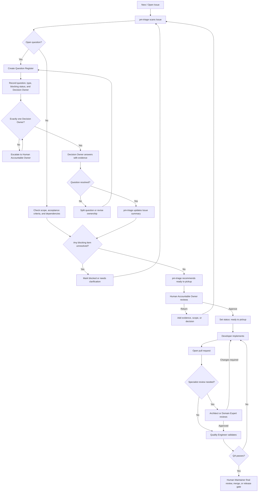

# Agent Governance and PM Triage Workflow

## Purpose

This document defines how independent agents collaborate on GitHub Issues and
pull requests. It was triggered by the current set of open Issues containing
unresolved questions across product, architecture, implementation, quality,
TPT, and social-content domains, including Issues #187–#192.

The goal is to make responsibility explicit before work starts. It is not a
replacement for the repository's content, layout, or release requirements.

## Core rules

1. Every open question has exactly one Decision Owner.
2. Other agents may be consulted, but they provide input rather than competing
   answers.
3. Cross-domain questions must be split into separate questions with separate
   Decision Owners.
4. `pm-triage` owns routing, completeness, and follow-up; it must not guess
   answers outside its authority.
5. Only the Human Accountable Owner may approve `status: ready to pickup`.
6. An Issue remains blocked when a blocking question, dependency, or required
   acceptance criterion is unresolved.
7. A decision must include its conclusion and the evidence or reasoning that
   supports it.

## Roles and decision boundaries

### `pm-triage`

- Scans new and existing Issues for open questions.
- Splits compound questions into single decision units.
- Classifies each question as product, architecture, implementation, domain,
  quality, or process.
- Assigns one Decision Owner and identifies consulted agents.
- Marks questions as blocking or non-blocking.
- Updates the Issue with the decision register and triage summary.
- Recommends `ready to pickup` only after all blocking questions are resolved.

`pm-triage` does not make architecture, product, domain, or release decisions
on behalf of the designated owner.

### Decision Owner

The Decision Owner gives the authoritative answer to one open question,
records the rationale, and identifies any resulting scope or dependency change.

Typical ownership:

- Product scope, audience, priority, and acceptance intent: Product Manager or
  Product Owner.
- Architecture, interfaces, storage boundaries, and system trade-offs:
  Architect.
- Code-level implementation details: Developer.
- TPT listing, packaging, and teacher-facing marketplace requirements:
  TPT Expert.
- Instagram or Facebook format and channel requirements: the corresponding
  domain expert.
- Test strategy, verification evidence, and release quality: Quality Engineer.

### Human Accountable Owner

The Human Accountable Owner is accountable for the governance process, not for
answering every question. This person:

- Approves the role charter and routing rules.
- Reviews high-risk or cross-domain triage summaries.
- Resolves escalations when the designated owners cannot reach a decision.
- Audits a sample of routine triage decisions.
- Gives the final approval for `status: ready to pickup`.
- Updates the governance rules when repeated failures show that a boundary is
  unclear.

## Workflow



## Issue decision register

For each open question, the Issue should record a compact register like this:

```markdown
## Decision Register

| ID | Question | Type | Blocking | Decision Owner | Consulted | Status |
|---|---|---|---|---|---|---|
| Q1 | ... | architecture | yes | architect | developer | open |

### Decision Q1

- Conclusion: ...
- Evidence: ...
- Scope/dependency impact: ...
```

The triage summary should state:

```markdown
## Triage Summary

- Blocking questions: 0
- Non-blocking questions: 0
- Human review required: yes/no
- Ready to pickup: recommended/not recommended
- Reason: ...
```

## Readiness rule

`pm-triage` may recommend `status: ready to pickup` only when:

- the Issue scope is understandable;
- acceptance criteria are testable;
- every open question has an owner and a recorded conclusion, or is explicitly
  marked non-blocking;
- dependencies are identified and not blocking execution; and
- the required human review has occurred.

The existing repository governance remains authoritative: human review is
required before an Issue receives `status: ready to pickup`, and blocked work
must not be picked up.

The reusable project skill for applying this process is
`skills/pm-triage/SKILL.md`.

## Label-to-agent queue

The `Queue agent handoff` workflow creates one idempotent queue comment when an
Issue receives one of these labels:

- `needs-triage` routes to `agent: pm-triage`.
- `decision-owner: architect`
- `decision-owner: product-manager`
- `ready-for-agent`
- `status: ready to pickup`

The two ready-for-agent labels require exactly one supported `agent:` label:
`pm-triage`, `architect`, `product-manager`, `social-expert`, `developer`, or
`quality-engineer`. Missing or conflicting routing adds `needs-info` and records
a blocked handoff instead of choosing a role.

This is a queue producer, not a model runner. GitHub Actions does not call
OpenAI or another external model. Codex pickup uses the versioned
`CODEX_HANDOFF:v1` runner described below; after an agent responds,
`pm-triage` records the decision and evidence.

## Versioned agent handoff protocol

Agents communicate through an Issue or Pull Request comment containing one
machine-readable `<!-- CODEX_HANDOFF:v1 ... -->` marker. The contract is
validated by `src/agent-handoff.mjs`; `handoffId` is the idempotency key, so a
router must not apply labels or create a second routing comment for an ID
already seen on the work item.

The normal role chain is:

```text
pm-triage
  → product-manager / architect / social-expert
  → pm-triage
  → Human approval
  → developer
  → quality-engineer
  → specialist review
  → Human merge
```

`.github/workflows/handoff-router.yml` performs coordination only: it validates
the marker, checks duplicates, derives `agent:*` and `state:*` labels, and
records the next handoff. It never calls an LLM. The Codex pickup runner reads
eligible work through `scripts/github-app-command.mjs`, claims at most one
item, starts from the latest remote `main` in a dedicated worktree, performs
the role's work, and writes the next handoff comment. A blocked handoff returns
to `pm-triage` with an explicit blocker; an invalid transition fails closed.

`status: ready to pickup` is the human approval gate. The derived
`state: ready-to-pickup` label is only a routing state and never grants
permission to implement.

## Recovery rules

- A blocked handoff returns to `pm-triage` with the blocker and evidence.
- A duplicate `handoffId` is ignored without a second comment or label change.
- A stale claim is not silently released; a human or `pm-triage` must verify it
  before using the guarded `release` command.
- A GitHub connectivity failure is a blocker, never an empty queue and never a
  reason to claim work from local assumptions.
- The offline route proof is in
  `tests/agent-workflow-integration.test.mjs` and uses no token or network.
