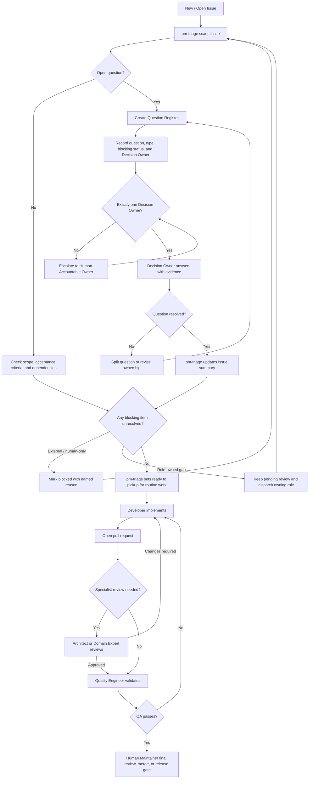

# Agent Governance and PM Triage Workflow

## Purpose

This document defines how independent agents collaborate on GitHub Issues and
pull requests. It was triggered by the current set of open Issues containing
unresolved questions across product, architecture, implementation, quality,
TPT, and social-content domains, including Issues #187–#192.

The goal is to make responsibility explicit before work starts. It is not a
replacement for the repository's content, layout, or release requirements.

## Core rules

1. Every open question has exactly one Decision Owner.
2. Other agents may be consulted, but they provide input rather than competing
   answers.
3. Cross-domain questions must be split into separate questions with separate
   Decision Owners.
4. `pm-triage` owns routing, completeness, and follow-up; it must not guess
   answers outside its authority.
5. `pm-triage` may route routine work directly to `status: ready to pickup` when its inputs, dependencies, and acceptance criteria are complete.
6. An Issue remains blocked only when a named external dependency, required
   input, unavailable permission, or explicit human-only gate is unresolved.
   Missing acceptance criteria, unclear routing, and ordinary dependency
   classification are role-owned remediation work: keep the Issue in
   `status: pending review` and dispatch the role that can resolve it.
7. A decision must include its conclusion and the evidence or reasoning that
   supports it.

Routine review policy:

- `Review gate: routine` means deterministic validation and QA are sufficient;
  no human content review is requested.
- Human decisions are reserved for `ui-design`, `final-copy`, `final-product`,
  `credentials`, or `public-dispatch`.
- Final merge remains an operational human gate under the current automation
  contract, not a request for ordinary code or content review.

## Roles and decision boundaries

### `pm-triage`

- Scans new and existing Issues for open questions.
- Splits compound questions into single decision units.
- Classifies each question as product, architecture, implementation, domain,
  quality, or process.
- Assigns one Decision Owner and identifies consulted agents.
- Marks questions as blocking or non-blocking.
- Updates the Issue with the decision register and triage summary.
- Routes `ready to pickup` only after all blocking questions and required inputs are resolved.
- Owns ordinary completeness repair. If acceptance criteria, scope wording, or
  dependency classification is incomplete but can be resolved from the Issue
  and repository evidence, PM triage must repair it and keep the Issue in
  `status: pending review`; it must not create a Human Accountable Owner gate.

`pm-triage` does not make architecture, product, domain, or release decisions
on behalf of the designated owner.

PM triage has a proactive queue-audit duty. On each scheduled cycle it inspects
all open Issues and open PRs, classifies why each item is or is not pickup-ready,
and records `CODEX_TRIAGE_AUDIT:v1` evidence even when the eligible set is empty.
It may normalize only unambiguous routine label aliases or stale derived labels
proved by handoff evidence. Multiple plausible owners or statuses must remain
unresolved and be returned as a named reconciliation blocker; PM triage must not
guess or change product, architecture, domain, implementation, quality, or
release decisions.

An ownerless `status: ready to pickup` is a repairable metadata defect, not a
reason to stop at “no eligible Issue”. PM triage may add `agent: developer` only
when the Issue explicitly declares `CODEX_RECONCILE_TO: developer`, validated
inputs, testable acceptance criteria, closed dependencies, a non-parent
implementation kind, and `Review gate: routine`. If any evidence is missing,
PM triage must atomically replace the invalid pickup state with
`agent: pm-triage` and `status: blocked`, record the missing owner/routing
evidence, and re-audit. No role may be inferred from a title or content label.

### `quality-engineer`

The quality engineer owns independent verification after implementation. QE
maps each acceptance criterion to reproducible commands, workflow evidence, and
artifacts, keeping content, mathematics, source, layout/PDF, visual, workflow,
and deterministic checks separate. QE returns concrete defects or missing
implementation evidence to `developer` with a rejected handoff, and returns
external dependencies, missing inputs, permissions, or ambiguous human-only
decisions to `pm-triage` as blocked. A passing routine QA may move to
`ready-for-human`; QE never merges, publishes, dispatches, or silently changes
the accepted scope.

### Decision Owner

The Decision Owner gives the authoritative answer to one open question,
records the rationale, and identifies any resulting scope or dependency change.

Typical ownership:

- Product scope, audience, priority, and acceptance intent: Product Manager or
  Product Owner.
- Architecture, interfaces, storage boundaries, and system trade-offs:
  Architect.
- Code-level implementation details: Developer.
- TPT listing and teacher-facing marketplace requirements: Product Manager;
  technical packaging and orchestration: Architect. Split mixed questions.

### `product-manager` responsibility boundary

`product-manager` is eligible only when it is the single Decision Owner on an
explicit product row and the Issue has `agent: product-manager` plus
`state: decision-requested`. It decides audience, product scope, priority,
acceptance intent, and offer facts from supplied evidence. It records one
conclusion, rationale, and scope/dependency impact, then hands the Issue back to
`pm-triage` with `CODEX_HANDOFF:v1`.

It must not answer architecture, implementation, domain, quality, process, or
release questions; mutate workflow labels; merge, publish, or dispatch; approve
UI adoption; or invent missing evidence. Missing evidence or a misrouted
question is a named `pm-triage` blocker. Human requests are limited to one
explicit UI/UX, final-copy, final-product, credential/access, public
publication, or downstream-dispatch decision.

### `architect` responsibility boundary

`architect` is eligible only when it is the single Decision Owner on an
explicit technical row and the Issue has `agent: architect` plus
`state: decision-requested`. It decides system boundaries, schemas, interfaces,
storage/artifact boundaries, orchestration and failure policy, dependency
direction, technical trade-offs, and technical acceptance criteria from
repository evidence. It records one conclusion, alternatives, interface or
behavior impact, migration/failure impact, and verification implications, then
hands the Issue back to `pm-triage` with `CODEX_HANDOFF:v1`.

It must not answer product, implementation, domain, quality, process, or release
questions; mutate workflow labels; merge, publish, or dispatch; or invent
performance requirements, platform limits, or product intent. Missing technical
evidence is a named `pm-triage` blocker.

### `social-expert` responsibility boundary

`social-expert` is eligible only when it is the single Decision Owner on an
explicit social row and the Issue has `agent: social-expert` plus
`state: decision-requested`. It decides Instagram/Facebook channel constraints,
Reel/Carousel format, cadence, social copy adaptation, CTA/hashtag requirements,
and the social asset contract from repository evidence. It records one
conclusion, alternatives, scope impact, channel/format and asset-contract
verification, then hands the Issue back to `pm-triage` with `CODEX_HANDOFF:v1`.

It must not answer product, architecture, implementation, domain, quality,
process, or release questions; mutate workflow labels; merge, publish, dispatch,
or access credentials; or invent platform limits, source availability, approved
assets, permissions, performance claims, or final copy. Missing platform, source,
or asset evidence is a named `pm-triage` blocker. Public publication,
downstream dispatch, final copy, UI adoption, and final-product decisions remain
explicit human-only gates when actually required.
- Instagram or Facebook format and channel requirements: the corresponding
  domain expert.
- Test strategy, verification evidence, and release quality: Quality Engineer.

### Human Accountable Owner

The Human Accountable Owner is accountable for the governance process, not for
answering every question. This person:

- Approves the role charter and routing rules.
- Reviews high-risk or cross-domain triage summaries.
- Resolves escalations when the designated owners cannot reach a decision.
- Audits a sample of routine triage decisions.
- Reviews only explicit human-only gates: UI/UX adoption, credential/account changes, publication, downstream dispatch, and final merge/release approval.
- Updates the governance rules when repeated failures show that a boundary is
  unclear.

## Workflow



## Issue decision register

For each open question, the Issue should record a compact register like this:

```markdown
## Decision Register

| ID | Question | Type | Blocking | Decision Owner | Consulted | Status |
|---|---|---|---|---|---|---|
| Q1 | ... | architecture | yes | architect | developer | open |

### Decision Q1

- Conclusion: ...
- Evidence: ...
- Scope/dependency impact: ...
```

The triage summary should state:

```markdown
## Triage Summary

- Blocking questions: 0
- Non-blocking questions: 0
- Human review required: yes/no
- Ready to pickup: recommended/not recommended
- Reason: ...
```

## Readiness rule

`pm-triage` may set `status: ready to pickup` for routine implementation when:

- the Issue scope is understandable;
- acceptance criteria are testable;
- every open question has an owner and a recorded conclusion, or is explicitly
  marked non-blocking;
- dependencies are identified and not blocking execution; and
- required inputs exist and the work is not behind a human-only gate.

`status: ready to pickup` is an atomic derived state, never a standalone
label. Entering it requires exactly one supported `agent:` owner in the same
complete labels replacement. Implementation work must use `agent: developer`;
social producers must declare their explicit social owner. Workflows must not
remove `status: blocked` and add `status: ready to pickup` in separate API
calls. The shared `buildAtomicReadyPickupLabels()` helper and governance
validators fail closed on ownerless or multi-owner pickup states.

Human review is not a blanket precondition for ordinary implementation. It is
required only for explicit human-only gates. Use `ready-for-human` plus one
`HUMAN_DECISION_REQUEST:v1` comment naming the exact decision.

### `ready-for-human` integrity invariant

The `ready-for-human` label is derived state, not evidence by itself. It is
valid only when the Issue declares either `Review gate: final-merge` for the
operational merge action, or one of the explicit human decision gates
(`ui-design`, `final-copy`, `final-product`, `credentials`, or
`public-dispatch`) and has exactly one `HUMAN_DECISION_REQUEST:v1` comment.
Routine work must fail closed and remain outside the human gate until its
operational `final-merge` gate is explicitly declared. Handoff and PR routers
must verify this invariant before adding `ready-for-human`.

For a release approval, the owner replies with one `HUMAN_APPROVAL:v1`
comment that includes the exact `Release identity` from the Issue. The
approval is valid only when that identity matches the current release
manifest; the approval workflow then moves the Issue to `status: ready to
dispatch`. It must not rerun generation as part of approval.

The reusable project skill for applying this process is
`skills/pm-triage/SKILL.md`.

## Label-to-agent queue

The `Queue agent handoff` workflow creates one idempotent queue comment when an
Issue receives one of these labels:

- `status: pending review` routes to `agent: pm-triage`.
- `status: ready to pickup`

Routine pickup requires exactly one supported `agent:` label:
`pm-triage`, `architect`, `product-manager`, `social-expert`, `developer`, or
`quality-engineer`. Missing or conflicting routing records a blocked handoff
instead of choosing a role.

This is a queue producer, not a model runner. GitHub Actions does not call
OpenAI or another external model. Codex pickup uses the versioned
`CODEX_HANDOFF:v1` runner described below; after an agent responds,
`pm-triage` records the decision and evidence.

Developer scope is fail-closed: pickup requires exactly `agent: developer` plus
`status: ready to pickup`, validated inputs, resolved dependencies, testable
acceptance criteria, and no explicit human decision gate. The developer may
implement and test the accepted scope, but may not expand scope, invent missing
inputs, merge, publish, dispatch, enable auto-merge, or alter human-gate labels.
Completion requires reproducible evidence and one handoff to
`quality-engineer`; missing inputs or dependencies return to `pm-triage` with a
named blocker.

## Canonical release state machine

Publication and downstream dispatch use one exclusive sequence:

```text
status: qa
  → ready-for-human
  → status: ready to dispatch
  → status: done
```

`ready-for-human` means QA is complete and one specific Human Accountable
Owner decision is still required. `status: ready to dispatch` means the
decision was approved for the exact immutable release identity and the
dispatch may begin. It never means "approval still pending". A metadata-only
workflow rerun preserves the release identity; any changed publishable
artifact hash returns the Issue to `ready-for-human`.

## Versioned agent handoff protocol

Agents write one compact `CODEX_HANDOFF:v1` comment only when the current
owner or workflow state changes. Polling, queue scans, and internal checks do
not create handoff comments. The comment names only the current Issue, From,
To, transition reason, evidence, satisfied or missing preconditions, human
decision status, next action, and return path. The router must be idempotent
for the release identity or handoff ID and must not create duplicate routing
comments.

The compact comment shape is:

```markdown
<!-- CODEX_HANDOFF:v1 -->
- Handoff ID: `repo:123:developer:quality-engineer:1`
- From: `developer`
- To: `quality-engineer`
- Work item: `owner/repo#123`
- Status: `completed`
- Next action: run the acceptance checks
- Evidence: PR check link and test command
- Blockers: none
- Return path: developer if QA rejects
```

The older list-shaped comment remains parseable for historical records, but
new pickup comments use this compact form.

The normal implementation chain is:

```text
pm-triage → domain owner or developer → quality-engineer → ready-for-human
```

### Unified role-output contract

Every new `CODEX_HANDOFF:v1` result carries one `outputKind`, one legal `To`,
one legal `Return path`, and explicit `Prerequisites satisfied` and
`Prerequisites missing` lists. The machine contract in
`src/role-output-contract.mjs` assigns exactly one output kind to each role:
triage decision, product decision, architecture decision, social decision,
implementation, or QA result.

The validator rejects mixed completed/blocked evidence, rejects completed or
accepted outputs with missing prerequisites, and permits an unsatisfied
prerequisite only on a `blocked` handoff returning to `pm-triage`. It also
enforces the role transition graph: domain decisions return to PM triage,
developer work goes to QE, QE rejection returns to developer, and successful
QE goes to `ready-for-human`.

At `ready-for-human`, the workstream stops until the named decision is
recorded. After approval it resumes at `status: ready to dispatch`; it does
not regenerate the package.

## Scheduled role eligibility

The scheduled dispatcher must allow `pm-triage` to pick up a readable
`status: pending review` Issue, including the ownerless bootstrap case. This is
the queue path for role-owned remediation such as missing acceptance criteria.
Legacy labels such as `needs-triage` and `state: decision-complete` are not
eligibility signals. `status: blocked` is reserved for a named external
dependency, missing required input, unavailable permission, or explicit
human-only gate and is not dispatched as routine PM work.

`.github/workflows/handoff-router.yml` performs coordination only: it validates
the marker, checks duplicates, derives canonical labels, and records the next
handoff. It never calls an LLM. The Codex pickup runner reads
eligible work through `scripts/github-app-command.mjs`, claims at most one
item, starts from the latest remote `main` in a dedicated worktree, performs
the role's work, and writes the next handoff comment. A blocked handoff returns
to `pm-triage` with an explicit blocker; an invalid transition fails closed.

`status: ready to pickup` is the routine implementation gate once PM triage has
recorded complete inputs, dependencies, and acceptance criteria. A
`ready-for-human` label is reserved for a specific human-only decision.

### Role-owned remediation versus true blockers

The distinction is operational, not cosmetic:

| Evidence | Queue state | Next actor | Human decision |
|---|---|---|---|
| Acceptance criteria or routing wording is incomplete but repository evidence is sufficient | `status: pending review` | PM triage or the named domain role | No |
| A domain decision is genuinely open | `state: decision-requested` | Named Decision Owner | No, unless the decision is explicitly human-only |
| Required monthly content, source data, permission, or an external dependency is absent | `status: blocked` | Named dependency owner or PM triage for routing | No |
| UI/UX adoption, final copy, final product adoption, credential/account change, publication, downstream dispatch, or final release approval | `ready-for-human` | Human Accountable Owner | Yes |

The Issue must say which evidence applies. A role must return a completed
handoff or a named true blocker; it must not leave a routine completeness gap
idle or convert it into a blanket Human Owner request. This rule was triggered
by Issue #216: its missing testable acceptance criteria were PM-owned
remediation, not a human decision or an external input blocker.

## Machine-readable work-item contract

Generated parent and implementation Issues declare their relationship in the
body; labels remain limited to owner, workflow status, type, and content. The
contract is:

```text
CODEX_WORK_ITEM_KIND: parent|implementation
CODEX_PARENT_KEY: monthly-production:YYYY-MM:parent
CODEX_DEPENDS_ON: owner/repository#123
CODEX_DEPENDS_ON_KEY: context-source
CODEX_INPUTS_VALIDATED: true
CODEX_RECONCILE_TO: developer
```

`CODEX_DEPENDS_ON` is preferred when the Issue number exists. A key dependency
resolves to the sibling Issue with the same monthly-production marker. An
implementation Issue is a verified developer pickup candidate only when its
dependencies are closed, inputs and acceptance criteria are declared, it has
exactly `agent: developer` and `status: ready to pickup`, and it is not a
parent. The implementation is in `src/issue-governance.mjs` and is tested by
`tests/issue-governance.test.mjs`.

## Automatic reconciliation and queue behavior

`.github/workflows/reconcile-issue-governance.yml` rechecks dependency closure
after Issue changes and on a scheduled sweep. It promotes a blocked child only
when the body explicitly opts into reconciliation with
`CODEX_RECONCILE_TO: developer` and `CODEX_INPUTS_VALIDATED: true`; otherwise
it leaves the Issue blocked for PM triage. This prevents a closed dependency
from silently bypassing missing inputs or acceptance criteria.

`.github/workflows/agent-pickup-queue.yml` announces only candidates returned
by the same validator. It separates PM triage intake from verified developer
pickup and never treats a label by itself as proof that work is ready.

The governance invariant suite runs locally with
`npm run governance:validate` and in `.github/workflows/governance-invariants.yml`.

## Recovery rules

- A blocked handoff returns to `pm-triage` with the blocker and evidence.
- A duplicate `handoffId` is ignored without a second comment or label change.
- Queue health is audited by `src/queue-health-recovery.mjs` and
  `.github/workflows/pm-triage-queue-audit.yml` across open and closed Issues.
- A stale role claim is released only when `state: claimed`, the claim
  timestamp, claim role, and canonical owner agree and the age exceeds the
  configured threshold. Missing or conflicting claim evidence returns a named
  PM blocker.
- A closed Issue with active owner/status/state labels is reconciled to
  terminal `status: done` without reopening or dispatching it.
- An Issue linked to a merged PR is reconciled to terminal `status: done`; the
  Issue is not closed automatically and no new agent is dispatched.
- A failed workflow run returns to the explicitly identified role (`developer`,
  `quality-engineer`, or `pm-triage`) and requires that role to investigate.
  If the run has no unambiguous role, the recovery comment is diagnostic only
  and the item remains a PM blocker.
- A GitHub connectivity failure is a blocker, never an empty queue and never a
  reason to claim work from local assumptions.
- The offline route proof is in
  `tests/agent-workflow-integration.test.mjs` and uses no token or network.
