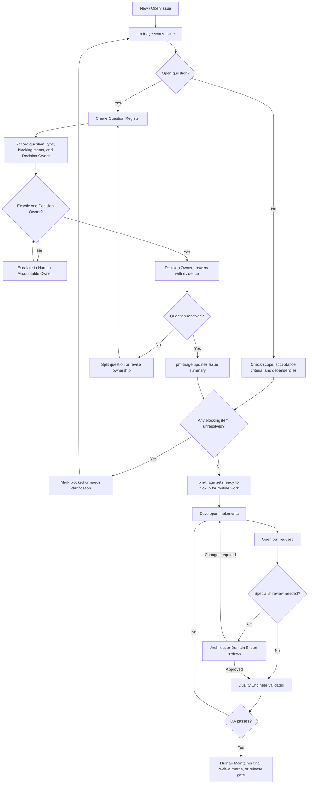

# Agent Governance and PM Triage Workflow

## Purpose

This document defines how independent agents collaborate on GitHub Issues and
pull requests. It was triggered by the current set of open Issues containing
unresolved questions across product, architecture, implementation, quality,
TPT, and social-content domains, including Issues #187–#192.

The goal is to make responsibility explicit before work starts. It is not a
replacement for the repository's content, layout, or release requirements.

## Core rules

1. Every open question has exactly one Decision Owner.
2. Other agents may be consulted, but they provide input rather than competing
   answers.
3. Cross-domain questions must be split into separate questions with separate
   Decision Owners.
4. `pm-triage` owns routing, completeness, and follow-up; it must not guess
   answers outside its authority.
5. `pm-triage` may bootstrap a readable `status: pending review` Issue, assign exactly one `agent:*` owner, and set the next legal state without answering another role's domain question.
6. An Issue remains blocked when a blocking question, dependency, or required
   acceptance criterion is unresolved.
7. A decision must include its conclusion and the evidence or reasoning that
   supports it.
8. Human Accountable Owner review is required after a UI/UX or visual preview is complete and before adoption, for new or elevated key/token/account access, and before public publication or downstream dispatch.
9. Required inputs are hard gates. Missing monthly content, final PDF, canonical reference, source data, approved brand asset, or another declared input must produce a named blocked reason.

## Roles and decision boundaries

### `pm-triage`

- Scans new and existing Issues for open questions.
- Splits compound questions into single decision units.
- Classifies each question as product, architecture, implementation, domain,
  quality, or process.
- Assigns one Decision Owner and identifies consulted agents.
- Marks questions as blocking or non-blocking.
- Updates the Issue with the decision register and triage summary.
- Recommends `ready to pickup` only after all blocking questions are resolved.
- May add or correct one `agent:*` owner label during bootstrap routing.
- May move `status: pending review` to `state: decision-requested`, `status: blocked`, `status: ready to pickup`, or `ready-for-human` when the evidence supports that transition.

`pm-triage` does not make architecture, product, domain, or release decisions
on behalf of the designated owner.

### Decision Owner

The Decision Owner gives the authoritative answer to one open question,
records the rationale, and identifies any resulting scope or dependency change.

Typical ownership:

- Product scope, audience, priority, and acceptance intent: Product Manager or
  Product Owner.
- Architecture, interfaces, storage boundaries, and system trade-offs:
  Architect.
- Code-level implementation details: Developer.
- TPT listing, packaging, and teacher-facing marketplace requirements:
  TPT Expert.
- Instagram or Facebook format and channel requirements: the corresponding
  domain expert.
- Test strategy, verification evidence, and release quality: Quality Engineer.

### Human Accountable Owner

The Human Accountable Owner is accountable for the governance process, not for
answering every question. This person:

- Approves the role charter and routing rules.
- Reviews high-risk or cross-domain triage summaries.
- Resolves escalations when the designated owners cannot reach a decision.
- Audits a sample of routine triage decisions.
- Reviews UI/UX and visual previews before adoption, approves new or elevated key/token/account access, and approves public publication or downstream dispatch.
- Updates the governance rules when repeated failures show that a boundary is
  unclear.

## Workflow



## Issue decision register

For each open question, the Issue should record a compact register like this:

```markdown
## Decision Register

| ID | Question | Type | Blocking | Decision Owner | Consulted | Status |
|---|---|---|---|---|---|---|
| Q1 | ... | architecture | yes | architect | developer | open |

### Decision Q1

- Conclusion: ...
- Evidence: ...
- Scope/dependency impact: ...
```

The triage summary should state:

```markdown
## Triage Summary

- Blocking questions: 0
- Non-blocking questions: 0
- Human review required: yes/no
- Ready to pickup: recommended/not recommended
- Reason: ...
```

## Execution authority and gates

Agents may act autonomously when an Issue has one owner, complete declared inputs, resolved dependencies, and work within the role boundary.

- **UI/UX gate:** an agent may implement and render previews, but the Human Accountable Owner reviews the preview and evidence before adoption.
- **Credential gate:** agents may use an existing authorized secret through the approved runtime interface without reading or exporting its value. New credentials, account access, permission elevation, rotation, or external login require Human Accountable Owner approval.
- **Input gate:** monthly content, final PDF, canonical references, source data, brand assets, and other declared inputs must exist and pass validation before generation or dispatch.
- **Release gate:** QA may mark work ready for human review, but only the Human Accountable Owner may approve public publication, downstream dispatch, or merge.

## Bootstrap and handoff rule

An Issue with `status: pending review` and a readable scope enters `pm-triage` bootstrap even when it does not yet have an `agent:*` label. `pm-triage` assigns exactly one owner, records a `CODEX_HANDOFF:v1` comment, and sets one outcome: `state: decision-requested`, `status: blocked` with a named dependency or missing input, `status: ready to pickup` with the assigned implementation owner, or `ready-for-human` for a human approval gate.

No agent may claim an Issue with multiple `agent:*` labels, an unresolved dependency, a missing required input, or an unapproved high-risk gate.

## Human decision request contract

Whenever work cannot proceed because a Human Accountable Owner must decide,
the Issue comment must begin with `HUMAN_DECISION_REQUEST:v1` and answer every
field below. A label such as `ready-for-human` or `state: human-review` is not
enough on its own.

```markdown
HUMAN_DECISION_REQUEST:v1

- Issue: #<number>
- Decision needed: <one concrete question>
- Why now: <what work is waiting and why this decision is the gate>
- Options:
  - A: <option and consequence>
  - B: <option and consequence>
- Recommendation: <one option, or `none` when the agent cannot recommend>
- Evidence: <links, files, tests, previews, or prior decisions>
- Blocked until decided: <exact actions that must not start>
- Decision owner: Human Accountable Owner
- After approval: <exact next label/state and next role>
- After revision: <where the revised input returns>
- After rejection: <close, defer, or alternate route>
```

The comment must contain one decision only. If several decisions are needed,
create one numbered request per decision and name the dependency between them.
The requester must not silently convert a human decision into an agent answer.

## Transition record contract

Every state or owner transition must include one `CODEX_HANDOFF:v1` comment
using this structure. This is the human-readable audit trail for why a task
changed hands.

```markdown
CODEX_HANDOFF:v1

- Issue: #<number>
- From: <current state / owner>
- To: <next state / owner>
- Transition reason: <one sentence>
- Evidence: <specific comment, dependency, file, check, or URL>
- Preconditions satisfied: <list, or `none`>
- Preconditions still missing: <list, or `none`>
- Human decision needed: <yes/no>
- Next action: <the next actor's concrete action>
- Return path: <where the task goes if rejected or blocked>
```

Use these meanings consistently:

| Current state | Next state | Meaning | Next actor |
|---|---|---|---|
| `status: pending review` | `state: decision-requested` | A named domain decision is still open | named Decision Owner |
| `status: pending review` | `status: blocked` | A dependency or required input prevents progress | named dependency owner or Human Accountable Owner |
| `status: pending review` | `ready-for-human` | Agent analysis is complete; human approval is the gate | Human Accountable Owner |
| `ready-for-human` | `status: ready to pickup` | The named human approval is recorded and implementation may begin | Developer or named implementation owner |
| `status: ready to pickup` | `state: implementation` | The assigned developer has started work | Developer |
| `state: implementation` | `status: qa` | Implementation is complete and verification is requested | Quality Engineer |
| `status: qa` | `state: changes-requested` | QA found a concrete defect or missing evidence | Developer |
| `status: qa` | `ready-for-human` | QA passed and a human-only gate remains | Human Accountable Owner |
| any blocked state | prior legal state | The named dependency or decision is resolved | PM triage recalculates routing |

Do not use a transition label without the matching handoff comment. A handoff
is complete only when the comment names the current state, next state, next
actor, evidence, and concrete next action.

## Readiness rule

`pm-triage` may set `status: ready to pickup` for routine implementation when:

- the Issue scope is understandable;
- acceptance criteria are testable;
- every open question has an owner and a recorded conclusion, or is explicitly
  marked non-blocking;
- dependencies are identified and not blocking execution; and
- required inputs exist and the work is not behind a human-only gate.

Human review is not a blanket precondition for ordinary implementation. It is
required only for the explicit gates: UI/UX or visual adoption, new or
elevated credentials/accounts, public publication, downstream dispatch, and
final merge/release approval. Those gates must use `ready-for-human` plus a
single `HUMAN_DECISION_REQUEST:v1` comment naming the exact decision.
