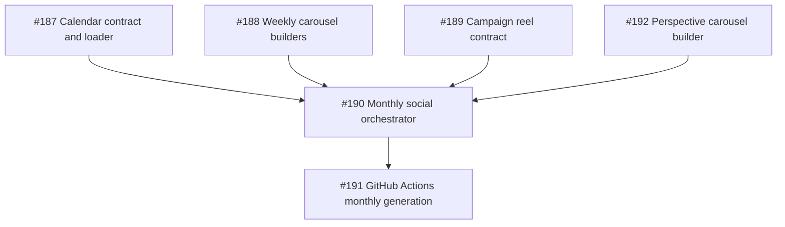

# First PM Triage Pass: Issues #187–#192

**Date:** 2026-10-14

**Purpose:** Record the first evidence-backed triage pass after the agent
governance workflow was merged in PR #195.

## Dependency graph

The dependency direction is derived from the Issue bodies: #187 defines the
calendar input consumed by #190; #188, #189, and #192 provide builders or
contracts dispatched by #190; #191 runs the orchestrator and therefore depends
on #190.

## Triage results

### Issue #187 — Define the social calendar contract and loader

Source: [Issue #187](https://github.com/joycytao/what-happened-on-this-day-math/issues/187)

| ID | Question | Type | Blocking | Decision Owner | Consulted | Status |
|---|---|---|---|---|---|---|
| 187-Q1 | Should runtime read `.xlsx` directly or consume committed CSV/JSON? | architecture | yes | `architect` | `developer`, `product-manager` | open |

**Triage:** This is an integration-boundary decision and blocks a stable loader
contract. It must be answered before #190 can depend on the loader.

**Readiness:** Not recommended. The question is unresolved.

### Issue #188 — Add weekly learning-system and clean-worksheet carousel builders

Source: [Issue #188](https://github.com/joycytao/what-happened-on-this-day-math/issues/188)

| ID | Question | Type | Blocking | Decision Owner | Consulted | Status |
|---|---|---|---|---|---|---|
| 188-Q1 | What are the final weekly slide counts? | product/domain | yes | `social-expert` | `product-manager`, `developer` | open |
| 188-Q2 | What is the exact input schema for dynamic dashboard numbers? | architecture/domain | yes | `architect` | `social-expert`, `developer` | open |

**Triage:** The two questions must be separated because slide-count approval
and input-contract design are different decisions. Both block implementation
without a stable output contract.

**Readiness:** Not recommended. Both questions are unresolved.

### Issue #189 — Integrate campaign Reel variants into the social build contract

Source: [Issue #189](https://github.com/joycytao/what-happened-on-this-day-math/issues/189)

| ID | Question | Type | Blocking | Decision Owner | Consulted | Status |
|---|---|---|---|---|---|---|
| 189-Q1 | Which campaign fields are mandatory for future campaigns? | product/domain | yes | `product-manager` | `social-expert` | open |

**Triage:** This determines the future input contract and required validation;
the implementation must not invent offer facts or fields.

**Readiness:** Not recommended. The mandatory-field policy is unresolved.

### Issue #190 — Build the spreadsheet-driven monthly social orchestrator

Source: [Issue #190](https://github.com/joycytao/what-happened-on-this-day-math/issues/190)

| ID | Question | Type | Blocking | Decision Owner | Consulted | Status |
|---|---|---|---|---|---|---|
| 190-Q1 | Should one failed row fail the full run, or should valid rows continue with a failure report and non-zero exit? | architecture/quality | yes | `architect` | `quality-engineer`, `product-manager` | open |

**Triage:** This is a run-level failure policy. It affects orchestration,
reporting, exit codes, and CI behavior, so it blocks implementation and #191.

**Readiness:** Not recommended. The failure policy is unresolved.

### Issue #191 — Add GitHub Actions monthly social generation and review PR

Source: [Issue #191](https://github.com/joycytao/what-happened-on-this-day-math/issues/191)

| ID | Question | Type | Blocking | Decision Owner | Consulted | Status |
|---|---|---|---|---|---|---|
| 191-Q1 | What schedule and lead time should the monthly run use? | product/process | yes | `product-manager` | `social-expert` | open |
| 191-Q2 | Should binary media be committed, stored as CI artifacts, or handled through Git LFS/release storage? | architecture/operations | yes | `architect` | `developer`, `quality-engineer` | open |

**Triage:** The questions are independent and must not be answered by one
agent. Q1 is a publication-policy decision; Q2 is a storage and repository
architecture decision. Both block a safe workflow design.

**Readiness:** Not recommended. Both questions are unresolved.

### Issue #192 — Build the perspective Carousel generator

Source: [Issue #192](https://github.com/joycytao/what-happened-on-this-day-math/issues/192)

This Issue explicitly states `Open Questions: None currently`. No Decision
Register entry is required in this first pass.

**Triage:** No open question was found. The Issue still depends on the social
orchestrator contract in #190 for dispatch integration, and the agent does not
approve pickup on its own.

**Readiness:** Not recommended until the dependency and human approval are
confirmed.

## Overall result

- Blocking questions: 8
- Non-blocking questions: 0
- Issues with unresolved blocking questions: #187, #188, #189, #190, #191
- Issue with no open questions but a downstream dependency: #192
- `status: ready to pickup`: not recommended for this set
- Human review required: yes
